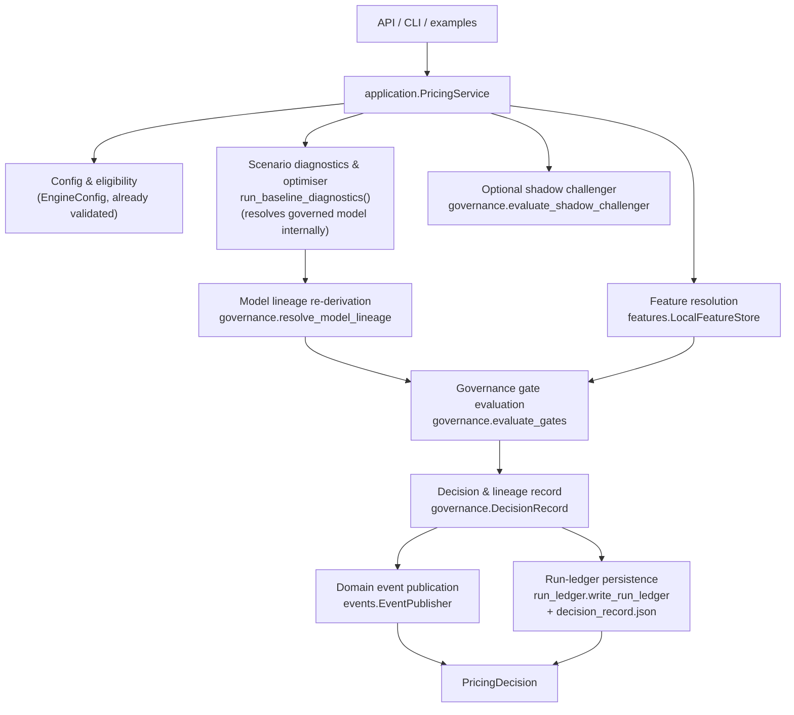

# Architecture Overview

The engine is organized as a small pipeline from assumptions to recommendations and diagnostics.

```text
configs/base.yaml
        |
        v
EngineConfig validation
        |
        v
synthetic customer generation
        |
        v
configured rate grids
  - market-relative spread grids
  - absolute fallback grids
        |
        v
response functions
  - home loan acceptance probability
  - term deposit uptake probability
  - optional approved-champion ML response adapter with synthetic fallback
        |
        v
economic objective
  + loan interest income
  - expected credit loss
  - capital charge
  - deposit interest cost
  - wholesale funding cost
  - funding shortfall penalty
  + excess deposit income
        |
        v
joint grid search
        |
        v
adaptive boundary follow-up
        |
        v
scenario diagnostics and sensitivity analysis
```

## Target Application Architecture (Modular Monolith)

The diagram above is the domain math pipeline. Around it, callers (the API, CLI, and
example scripts) go through a narrow application service instead of calling
`run_baseline_diagnostics()` directly:



This is a **modular monolith** (see `docs/adr/0001-modular-monolith-before-microservices.md`):
one deployable package with service-shaped internal boundaries, not a distributed system.
Note one sequencing nuance versus the idealised flow: `run_baseline_diagnostics(registry=...)`
already resolves the governed response function internally (existing behaviour, unchanged);
`PricingService` re-derives the same registry decision read-only afterwards
(`governance.lineage.resolve_model_lineage`) purely to attach lineage metadata, rather than
refactoring `scenarios/runner.py` to split "resolve" from "optimise" — see
`scenarios/runner.py`'s hotspot note below for why that refactor was deliberately not done.

New packages supporting this flow:

- `src/balance_pricing_engine/application/`: `PricingService.run_scenario()` — the single
  orchestration entry point. Accepts a `PricingScenarioRequest`, returns a `PricingDecision`.
  Imports no delivery-layer dependency (no FastAPI). `GovernanceError` from a broken approved
  champion propagates out unchanged — never downgraded to a soft decision.
- `src/balance_pricing_engine/features/`: `FeatureProvider` protocol, versioned/fingerprinted
  `FeatureSchema` definitions centralizing `modelling/datasets.py`'s column lists, and
  `LocalFeatureStore` (the only implementation today). See
  `docs/adr/0002-local-feature-store-interface.md`.
- `src/balance_pricing_engine/governance/`: `evaluate_gates()` (typed `GateResult`s →
  `DecisionStatus`), `resolve_model_lineage()`, `DecisionRecord` (+ additive
  `decision_record.json`), and a narrow champion/challenger `evaluate_shadow_challenger()`
  seam. See `docs/adr/0003-governance-centred-decision-record.md`.
- `src/balance_pricing_engine/events/`: immutable `DomainEvent`s and an `EventPublisher`
  protocol (`NoOpEventPublisher` / `InMemoryEventPublisher` / `JSONLEventPublisher` /
  `KafkaEventPublisher`, the last requiring the `[kafka]` extra and a real broker). See
  `docs/adr/0004-in-process-events-before-streaming-platform.md`.
- `src/balance_pricing_engine/observability/`: structured JSON logging, correlation-ID
  propagation, and `ExecutionMetrics` stage timing — standard library only.

## Main Modules

- `src/balance_pricing_engine/config.py`: loads and validates YAML configuration.
- `src/balance_pricing_engine/rate_grids.py`: builds configured pricing grids from either
  market-relative spreads or absolute product grids.
- `src/balance_pricing_engine/synthetic/`: generates synthetic customers, market state, and response
  probabilities.
- `src/balance_pricing_engine/pricing/`: calculates objective components such as loan income,
  credit loss, maturity-adjusted RWA capital charge, deposit cost, wholesale funding cost, and
  funding shortfall penalty.
- `src/balance_pricing_engine/optimization/grid_search.py`: evaluates rate pairs and selects the
  highest-objective result, optionally applying a portfolio ROE floor before winner selection.
- `src/balance_pricing_engine/diagnostics.py`: explains objective components, detects boundary
  issues, expands grids when needed, and runs sensitivity cases.
- `src/balance_pricing_engine/scenarios/runner.py`: orchestrates baseline scenario diagnostics and
  artifact persistence.
- `src/balance_pricing_engine/scenarios/multiperiod.py`: rolls baseline diagnostics across multiple
  future periods and discounts the resulting objective contributions.
- `src/balance_pricing_engine/run_ledger/`: creates governed pricing-run ledgers by wrapping
  diagnostics artifacts with metadata, configuration snapshots, pricing memos, and governance
  checklists.
- `src/balance_pricing_engine/modelling/`: builds synthetic observed datasets and trains
  response models, including optional LightGBM, XGBoost, and survival/hazard adapters. These models
  can influence optimization only when `run_baseline_diagnostics(registry=...)` resolves an
  approved compatible champion through `ModelScoringAgent`; otherwise the deterministic synthetic
  response functions remain in use.

## Extension Boundaries

`EngineConfig` is the validated input contract for scenario intent. It should remain a boundary for
assumptions such as market state, pricing mode, balance-sheet settings, response settings, and
multi-period controls. Avoid storing operational state, run outputs, or audit artifacts on
`EngineConfig`; those belong in diagnostics, ledgers, or generated artifacts.

`ScenarioDiagnostics` is the output contract for a completed scenario. It packages the winning
`OptimizationResult`, the evaluated grid surface, boundary metadata, optional cohort context, and
artifact writing. API, dashboard, reporting, LLM narration, run ledger, and multi-period flows should
consume this contract rather than reaching into optimizer internals.

The approved-champion ML path is an optional extension seam. The baseline runner may ask
`ModelScoringAgent` to resolve response functions from a registry, but only an approved compatible
champion with a loadable artifact is adapted into the optimizer. When no approved compatible
champion exists, the runner falls back to the deterministic synthetic response functions. An
approved champion whose artifact is missing or unloadable instead raises `GovernanceError` — that
inconsistent governed state must fail loud rather than silently reprice on synthetic.

`PricingDecision` is the application-level output contract for a *decision*, layered on top
of `ScenarioDiagnostics` rather than replacing it. It should remain the entry point for new
delivery surfaces (new API endpoints, CLI commands); it wraps `ScenarioDiagnostics` in
governance evaluation, lineage, and event publication without changing what
`ScenarioDiagnostics`/`OptimizationResult` mean or contain.

## Architecture Hotspots

`src/balance_pricing_engine/scenarios/runner.py` is the main orchestration hotspot. It currently
coordinates baseline execution, segmented pricing routing, diagnostics wrapping, artifact
persistence, cohort attribution, and segmented-to-standard result conversion. Keep future changes
small here; if responsibilities grow, prefer moving artifact writing or segmented conversion into
dedicated modules while preserving `ScenarioDiagnostics` as the public output contract.
`application.PricingService` orchestrates *around* this module (governance, lineage, events,
decision records) rather than inside it — that orchestration growth was deliberately kept out of
`runner.py` to avoid making this hotspot larger.

`src/balance_pricing_engine/modelling/agentic.py` is the governed modelling hotspot. It contains
model abstractions, registry governance, training, scoring, champion promotion, response adapters,
and fallback behavior. The current public surface is covered by tests, but future expansion should
prefer narrower modules such as registry, training, scoring, and response-model adapters while
keeping existing imports stable.

## Adaptive Boundary Flow

The baseline and sensitivity runners start with the configured grid. If the accepted result is at a
minimum or maximum boundary, the hit side of the grid is expanded by the current grid span and the
search is rerun. Expansion stops when the accepted result is no longer at a boundary or when the
maximum expansion count is reached.

The final `boundary_warning_flag` reports the accepted result after expansion. The
`initial_boundary_warning_flag` and `expansion_rounds` fields show whether remediation was needed.
If the final flag remains true, the optimum may still sit outside the searched domain and the
boundary issue should remain open for review.

## Multi-Period Scenario Roll

`MultiPeriodConfig` enables a portfolio-level scenario roll through
`run_multiperiod_diagnostics()`. Each period runs the standard baseline diagnostics with the period's
market assumptions, carries prior-period loan income and deposit cost as back-book economics, applies
`loan_runoff_rate` and `deposit_runoff_rate` to that back book each period, and reports a discounted
NPV using `discount_rate`.

The key configuration fields are `n_periods`, `loan_runoff_rate`, `deposit_runoff_rate`,
`discount_rate`, `reinvestment_spread_bps`, and `market_cash_rate_drift_bps`. Surviving back-book
loan balances earn a reinvestment rate of cash rate plus `reinvestment_spread_bps`. The cash-rate
drift shifts the cash rate used in later periods; competitor loan and deposit rates remain fixed, so
a warning is emitted when cash-rate drift is configured because competitor gaps will move
mechanically.

## Artifact Flow

`ScenarioDiagnostics.write_artifacts()` writes baseline regression outputs:

- `grid_results.csv`: every final evaluated rate pair
- `top_results.csv`: highest objective candidates
- `counterfactuals.csv`: one-axis objective decompositions for top candidates
- `cohort_attribution.csv`: expected winning volumes by coarse synthetic customer segment, when
  cohort context is available
- `sensitivity.csv`: sensitivity output, when provided
- `summary.json`: accepted recommendation and boundary metadata

The run ledger layer is the preferred output orchestration path for reproducible records.
`write_run_ledger()` creates a collision-safe directory under `data/outputs/runs/` using a single
UTC timestamp for both the directory name and `metadata.json`, then writes:

- `metadata.json`: run ID, timestamp, config hash, git/package details, and governance flags
- `config_snapshot.yaml`: exact YAML configuration used for the run
- the diagnostics artifacts listed above
- `pricing_memo.md`: business-facing recommendation, decomposition, sensitivity, and risk notes
- `governance_checklist.md`: manual review checklist for accepting the recommendation

Artifact filenames inside a ledger directory remain fixed. Reusing an output directory can overwrite
prior files, so run ledger directory creation is atomic and appends a numeric suffix if a same-timestamp
directory already exists.

## NZ pricing intelligence

Public NZ bank pricing enters the engine through a separate intelligence layer
that answers "what is the market doing?" and hands the optimiser a competitor
assumption. It never prices anything itself.

```text
Official NZ bank websites
   -> competitor_rates/collectors/{anz,asb,bnz,westpac,kiwibank}.py
   -> CompetitorRateRecord (canonical model + provenance)
   -> pricing_intelligence/validation.py
   -> pricing_intelligence/store.py            (SQLite historical observations)
   -> pricing_intelligence/changes.py          (RateChange events)
   -> pricing_intelligence/snapshot.py         (per-term ranking + dispersion)
   -> pricing_intelligence/strategy.py         <-- the only seam into pricing
   -> EngineConfig.market.competitor_loan_rate
   -> scenarios/runner.py -> optimization/grid_search.py
```

`strategy.apply_market_strategy_to_config()` supports `MANUAL` (default,
config returned unchanged), `MARKET_MEDIAN`, `MARKET_LEADER`,
`MARKET_SECOND_LOWEST`, and `MARKET_MEAN`, with an `offset_bps` shift.

Full detail: [pricing_intelligence.md](pricing_intelligence.md).


### Pricing Watch dashboard

The Streamlit console in [dashboard/](../src/balance_pricing_engine/dashboard/) is a thin
operating layer over the services above; the only dependency direction is
`dashboard → pricing_intelligence / scenario seams`, never the reverse (asserted by
`tests/unit/test_dashboard_boundaries.py`). Pages render view models returned by
`DashboardServices`, which wraps `PricingIntelligenceService`, `strategy` and
`pricing_scenario_trigger`; freshness, ranking, bps, market state and scenario economics
are never recomputed in the UI. Freshness and health have one implementation,
`pricing_intelligence/health.py`, shared by the CLI `health` command, the market
snapshot and the dashboard. Market Explorer assesses the selected trusted snapshot entry's
confirmation time with `health.is_stale`, rather than using bank-wide freshness across terms.
Operations & Trust (Data health) resolves the same trusted fallbacks as live snapshots before assessing age;
raw quarantine flags remain separate, and bank-wide age is the oldest trusted confirmation
across tracked terms. Scenario exclusions are scoped to the requested term. Stored scenario
results include a SHA-256 fingerprint of the loaded engine YAML; a changed or unavailable
configuration hides the recommendation until an explicit Run scenario action.
Snapshot entries carry quarantine provenance from the selected observation identity, so a
healthy sibling is never labelled as a fallback. Command Centre and Market Explorer use that same snapshot.
The bank × term matrix retains stale-only terms for audit. The frozen `selectable_terms` comes
from the live snapshot; all four term selectors use it, preferring 12 months only when available.
Selectors retain valid choices and reset unavailable ones to the live default. All-stale
markets show guidance, and scenario results for unavailable terms are hidden until an explicit rerun.
Scenario Lab renders static validation/option errors without exposing YAML values.
The macOS launcher verifies local listener ownership and the exact checkout command with
`lsof`/`ps`, checking PID/start time around health probes and before reusing a port. Startup
browser opening also requires the listener to be the launcher's own child; unavailable or
ambiguous identity prevents opening an occupied port.
Rate Movements matches historical metadata by observation key and event time. It retains audit
events with their rate category, but historical ranks and market
context are unavailable for events outside the snapshot's comparable tier.
Reads never reach `dashboard/actions.py`: only `views/operations.py` (reached solely
through the Operations & Trust composer) does, and live collection runs as a subprocess of the scheduled workflow
script behind a single-flight runner -- one `--product` subprocess per selected market (both by
default), each with its own lock, summary and reported result. See
[pricing_intelligence.md → Dashboard](pricing_intelligence.md#dashboard).

The 2026-10 redesign reorganised the console into six destinations (Command Centre, Market
Explorer, Rate Movements, Market Trends, Pricing Studio, Operations & Trust) without moving
any calculation: design tokens live in `theme.py`, reusable components in `ui.py`, charts in
`charts.py` and the templated Command Centre sentences in `insights.py` (all view-model
inputs only). Page modules live in `dashboard/views/` rather than `pages/`, because a
`pages/` folder beside the entry script puts Streamlit in legacy multipage mode until
`st.navigation` first runs, which broke deep links. See
[dashboard_redesign.md](dashboard_redesign.md).

The premium presentation refinement keeps those boundaries: `ui.render_chart` applies the
active native theme's text-mark colour, while `charts.py` remains Streamlit-free. Shared
metric grids reflow without altering their values. Market Trends supplies literal history
and benchmark tables alongside its step charts; Pricing Studio adds a comparison of the
existing modelled objective values. Operations places freshness, run and quarantine summaries
inside each product's health tab, using that product for every service read. The brand bar's
native **Market data status** disclosure retains both products' activity and freshness without
crowding mobile navigation. No collection or optimiser execution moved into a render path.

The console is dual-product: home loans (lending) and term deposits (funding) are separate
markets throughout. Every `DashboardServices` market read takes `product_type`
(default `HOME_LOAN`, so existing callers are unchanged) and passes it to *every* backend call
it makes — snapshot, exclusions, quarantine, activity, changes, history (including
`term_market_from_rates`, so a deposit leader on each date is the highest rate) and health.
Pages pass the product positionally through `cached`, which makes it part of the cache key.
Ranking direction, comparable tier (`special` vs `term_deposit`; PIE, managed-fund and
KiwiSaver rows excluded) and leader/second-best come from the backend, never the UI;
`dashboard/products.py` only names things (titles, ranking rule, icon, accent). Command Centre
shows both markets side by side, then one market in depth; Market Explorer, Rate Movements and
Market Trends carry a persistent product selector (`ui.product_selector`, shared through
session state, seedable with `?product=term_deposit`). Home-loan widgets keep their original
keys; deposit widgets are suffixed, so a term not offered for the new product resets safely.
Pricing Studio has three scenario types, each on an existing seam: home loan (loan-side
overlay), term deposit (`run_triggered_scenarios` with a deposit snapshot and
`apply_market_strategy_to_config(deposit_*)`; manual overrides via
`apply_manual_competitor_rate_to_config(product_type=TERM_DEPOSIT)`) and joint (both overlays,
market benchmarks only, no comparison set). Each type stores its own result, so a mortgage
result never renders under a deposit heading. See
[dashboard_redesign.md → Dual-product extension](dashboard_redesign.md#10-dual-product-extension-2026-10-24).

### Pricing-intelligence audit boundary (2026-09-06)

The strategy seam excludes configured `our_bank` before computing a benchmark;
public market snapshots retain the full market. Repeated suspicious readings
remain quarantined against the last trusted observation and cannot confirm their
own historical events. Clean recoveries use that trusted observation as the
change baseline. Observation/event writes remain atomic, with chronological
collection ordering per product. Store opening repairs legacy numeric-only
mortgage names and flags affected events, preserving the original rate history.
The dashboard uses presentation helpers for observation health; entirely failed
attempts still require the separate scheduled-run summary to be visible.
See the [audit](audits/2026-09-06-pricing-intelligence-audit.md) for evidence and limits.

## Module map (agent reference)

Last verified against `src/balance_pricing_engine/` on 2026-09-26. Moved here from the agent instructions; `AGENTS.md` points to it.

- [config.py](../src/balance_pricing_engine/config.py) — Pydantic v2 `EngineConfig` + `ResponseCoefficientsConfig`. Validates that **exactly one** of `pricing_strategy` (market-relative spreads) or `products` (absolute grids) is provided. Refuses spread grids that would generate negative rates. `model_validator(mode="after")` emits `warnings.warn` for: negative `wholesale_funding_spread`, penalty dominated by funding spread, `n_*_customers < 1000`, spread band < 50 bps.
- [market.py](../src/balance_pricing_engine/market.py) — `MarketRates`, `SpreadGridConfig`, `bps_to_rate`, `build_market_relative_grid`.
- [rate_grids.py](../src/balance_pricing_engine/rate_grids.py) — `build_configured_rate_grids`: dispatches between market-relative spread grids and absolute fallback grids.
- [synthetic/](../src/balance_pricing_engine/synthetic/) — `customers.py` (loan + deposit generators), `market.py` (`MarketState`), `response.py` (`loan_acceptance_probability`, `deposit_uptake_probability`).
- [pricing/](../src/balance_pricing_engine/pricing/) — `profit.py` (loan income, ECL, deposit cost, wholesale funding) + `balance_sheet.py` (`calculate_funding_result`, shortfall + penalty).
- [optimization/grid_search.py](../src/balance_pricing_engine/optimization/grid_search.py) — `evaluate_joint_rate_grid`, `select_best_result`, `optimize_joint_rates`, `optimize_joint_market_relative_rates`. Returns `OptimizationResult` dataclass with backward-compat aliases (`objective_value`, `deposit_cost`, `funding_penalty`, `loan_income_after_losses`). Accepts optional `loan_response_fn` / `deposit_response_fn` callables so an approved ML champion can drive acceptance/uptake instead of the synthetic response.
- [optimization/response_fn.py](../src/balance_pricing_engine/optimization/response_fn.py) — pluggable response interface that decouples the optimiser from the response source: `ResponseFn` Protocol, `SyntheticLoanResponseFn` / `SyntheticDepositResponseFn` adapters, `MLResponseFnAdapter` (wraps a scored ML model), and the governance guards `GovernanceError` / `require_approved`.
- [diagnostics.py](../src/balance_pricing_engine/diagnostics.py) — `BoundaryDiagnostics`, `ObjectiveDecomposition`, `evaluate_adaptive_joint_rate_grid` (boundary-expansion wrapper), `run_sensitivity_analysis` (returns `delta_loan_rate_bps`, `delta_deposit_rate_bps`, `delta_objective_pct`, `parameter_family`; accepts `n_seeds` for Monte Carlo cohort uncertainty). Default sensitivity cases perturb all four elasticities and two customer-feature coefficients by ±25%.
- [scenarios/runner.py](../src/balance_pricing_engine/scenarios/runner.py) — `run_baseline_diagnostics`, `ScenarioDiagnostics` dataclass, `write_artifacts()` persistence. `ScenarioDiagnostics` also exposes `counterfactual_decompositions(top_n)` and `cohort_attribution()`.
- [scenarios/experiments.py](../src/balance_pricing_engine/scenarios/experiments.py) — small scenario helpers (e.g. `run_higher_funding_penalty_scenario`).
- [run_ledger/](../src/balance_pricing_engine/run_ledger/) — governed pricing-run ledger layer. Single `write_run_ledger()` entry point (re-exported from `__init__.py`) orchestrates: `directory.py` (timestamped `data/outputs/runs/{timestamp}_{scenario_name}/` directory), `metadata.py` (`RunMetadata` dataclass + `build_run_metadata` + `write_run_metadata`), `config_snapshot.py` (YAML copy), `memo.py` (`write_pricing_memo` — markdown recommendation/decomposition/risk memo), `checklist.py` (`write_governance_checklist` — markdown approval checklist). Wraps `ScenarioDiagnostics.write_artifacts()` and adds new artifacts on top.
- [api/app.py](../src/balance_pricing_engine/api/app.py) — FastAPI serving layer. Exposes `POST /run-scenario` (original, stable — accepts YAML config string, returns optimization summary dict), `POST /v1/pricing/scenarios` (versioned, governed — backed by `application.PricingService`, typed request/response in [api/schemas.py](../src/balance_pricing_engine/api/schemas.py)), `GET /health`, `GET /ready`. Optional; not imported by core engine. Requires `fastapi` extra. Both `POST` routes carry `dependencies=[Depends(require_api_key)]` (see `api/auth.py`). [api/server.py](../src/balance_pricing_engine/api/server.py) — launcher used by the Dockerfile `CMD`; resolves optional direct-TLS kwargs from env vars (`resolve_tls_kwargs`) before calling `uvicorn.run`. [api/auth.py](../src/balance_pricing_engine/api/auth.py) — opt-in `X-API-Key` check (`require_api_key` FastAPI dependency); no-op unless `PRICING_ENGINE_API_KEYS` is set, reads it via `secrets.SecretsProvider`.
- [application/](../src/balance_pricing_engine/application/) — application-layer orchestration seam. `pricing_service.py` — `PricingService.run_scenario(request: PricingScenarioRequest) -> PricingDecision`: resolves feature lineage, calls `run_baseline_diagnostics(registry=...)`, resolves model lineage, evaluates governance gates, optionally runs the shadow-challenger seam and sensitivity analysis, optionally persists a run ledger + additive `decision_record.json`, publishes domain events, and returns a `PricingDecision`. Imports no delivery-layer dependency (no FastAPI). `contracts.py` — `PricingScenarioRequest`, `PricingDecision`, `GovernanceSummary`, `ExecutionContext`. `GovernanceError` from a broken approved champion propagates out of `run_scenario()` unchanged — never downgraded to a `BLOCKED` decision.
- [features/](../src/balance_pricing_engine/features/) — lightweight, versioned feature-store boundary for the synthetic diagnostic models only. `contracts.py` — `FeatureSchema` (name/version/columns/target + SHA-256 `fingerprint`), `FeatureLineage`, `FeatureProvider` protocol. `definitions.py` — centralizes `modelling/datasets.py`'s `LOAN_FEATURE_COLUMNS`/`DEPOSIT_FEATURE_COLUMNS` into versioned schemas. `local_store.py` — `LocalFeatureStore`, the only implementation, backed by existing synthetic dataset builders. Does not wire unapproved ML output into the optimizer; does not introduce personalised pricing.
- [governance/](../src/balance_pricing_engine/governance/) — governance control plane. `gates.py` — `GateStatus`/`GateResult`/`evaluate_gates()`/`DecisionStatus`/`decision_status_from_gates()`. `lineage.py` — `ModelLineage`, `resolve_model_lineage()` (read-only re-derivation of the same registry decision `ModelScoringAgent.resolve_response_fn` already made — does not duplicate its `GovernanceError` check). `decision_record.py` — `DecisionRecord`, `build_decision_record()`, `write_decision_record()` (additive `decision_record.json`). `shadow.py` — `evaluate_shadow_challenger()`: narrow, optional champion/challenger comparison; never alters selected rates, never raises.
- [events/](../src/balance_pricing_engine/events/) — in-process domain events. `models.py` — immutable `DomainEvent` + factory functions (`pricing_scenario_requested`, `pricing_decision_produced`, `governance_review_required`, `pricing_decision_blocked`, `model_resolved`, `run_ledger_written`). `publisher.py` — `EventPublisher` protocol, `NoOpEventPublisher` (default), `InMemoryEventPublisher` (tests), `JSONLEventPublisher` (local audit file), `KafkaEventPublisher` (requires `[kafka]` extra — blocks on send-future ack and raises on failure or timeout; failures propagate, not swallowed here, but every call site routes through `publish_safely()`, which logs rather than retries, so this is best-effort, not durable at-least-once delivery), `publish_safely()` (runs the publish on its own daemon thread — not a shared pool, so a permanently hung publisher can't pin every worker and degrade later requests too — capped at `MAX_CONCURRENT_PUBLISHES` in-flight threads via a semaphore so a sustained outage can't leak threads without bound either, and caps the wait at `deadline_seconds` (default 2s) so a slow/hung publisher can't stall the pricing path; catches/logs publish failures, including ones that finish late in the background, and drops (logs, doesn't spawn) any publish once the concurrency cap is hit — never fails the pricing decision).
- [observability/](../src/balance_pricing_engine/observability/) — `logging.py`: `configure_json_logging()`, `log_event()`, `ExecutionMetrics`, `stage_timer()`. Standard library only.
- [secrets/](../src/balance_pricing_engine/secrets/) — secrets-provider seam. `provider.py` — `SecretsProvider` Protocol (`get_secret(name) -> str | None`), `EnvSecretsProvider` (default), `StaticSecretsProvider` (dict-backed, tests/local dev). Swap point for a future Vault/AWS Secrets Manager/GCP Secret Manager adapter; currently used by `llm._client.build_client`/`is_llm_available` (for `ANTHROPIC_API_KEY`), `api.auth.require_api_key` (for `PRICING_ENGINE_API_KEYS`), and `pricing_intelligence.alerts.build_webhook_sink_from_env` (for `PRICING_INTELLIGENCE_ALERT_WEBHOOK_URL`).
- [llm/](../src/balance_pricing_engine/llm/) — Tier 4 LLM decision-support layer: `narrative.py` (plain-language scenario narration), `anomaly.py` (config anomaly detection), `model_validation.py` (`ModelValidationReportAgent` — validation-report narration for a `ModelRecord`, same deterministic-fallback/audit-log pattern as `narrative.py`), `_client.py` (Claude API wrapper; resolves `ANTHROPIC_API_KEY` via `secrets.SecretsProvider`), `scenario_interface.py` (natural-language scenario-run interface — decision-support only, requires human approval). `narrative.py`, `model_validation.py`, and `scenario_interface.py` each set `_DEFAULT_MODEL = "claude-sonnet-4-6"`. **Decision-support only** — every response tagged `[DECISION-SUPPORT: requires human review]`. Never wired into automated pricing decisions.
- [modelling/](../src/balance_pricing_engine/modelling/) — diagnostic ML layer:
  - `datasets.py` — feature schemas (`LOAN_FEATURE_COLUMNS`, `DEPOSIT_FEATURE_COLUMNS`) and dataset builders.
  - `models.py` — `build_logistic_regression_model`, `build_hist_gradient_boosting_model`, `fit_response_model`, `predict_response_probability`.
  - `evaluation.py` — `evaluate_probabilities(y_true, y_probability)` (pure metrics dict), `evaluate_model(model, frame, features, target)` (thin wrapper), `evaluate_calibration`, `compute_lift_table` / `check_lift_monotonicity`, `compute_rate_uplift` (two-point scenario-comparison uplift via `compute_partial_dependence` — not a trained causal model; the synthetic generators have no treatment/control structure to train one against).
  - `persistence.py` — joblib `save_model` / `load_model`.
  - `agentic.py` — **governed agentic workflow**: `ModelTrainingAgent`, `ModelScoringAgent`, `ModelRegistry`, `ModelRecord`, `TrainingConfig`, `TrainingResult`, plus `ElasticityBaselineModel`, `ElasticityResponseModel`, `LogisticResponseModel`, `HistGBMResponseModel`, `BootstrapEnsembleResponseModel` (bootstrap ensemble; `predict_probability` returns the ensemble mean so it slots into `train()` candidates unchanged, `predict_probability_quantiles` exposes per-row uncertainty bands from replica spread). Single `train(*, dataset, candidates, registry, ...)` entry point replacing the former dual `train` / `train_and_recommend` API.
  - `workflows.py` — orchestration helpers. `reports.py` — `train_response_model_report`, `build_champion_challenger_report`, `build_lift_stability_report` (bootstrap-resamples scored predictions to assess decile lift stability under sampling noise — not model-refit stability across training splits).
- [competitor_rates/](../src/balance_pricing_engine/competitor_rates/) — ingestion pipeline with its own CLI ([cli.py](../src/balance_pricing_engine/competitor_rates/cli.py)) and subcommands `fetch | fetch-interest-co-nz | validate | apply | report` (`fetch-interest-co-nz` pulls fallback rates from interest.co.nz aggregator tables). Backed by `sources.py` (official bank pages), `extractors.py`, `normalise.py`, `validate.py`, `store.py`, `apply.py`. [collectors/](../src/balance_pricing_engine/competitor_rates/collectors/) adds per-bank adapters (`anz.py`, `asb.py`, `bnz.py`, `westpac.py`, `kiwibank.py`) over a shared `base.py` that owns fetching, retry/backoff, snapshotting, enrichment and per-bank failure isolation — a bank changing its website should require editing only that bank's collector.
- [pricing_intelligence/](../src/balance_pricing_engine/pricing_intelligence/) — NZ public-market intelligence layer built **on top of** `competitor_rates`, not replacing it. `bps.py` (exact Decimal basis points), `config.py` (all thresholds/timeouts), `store.py` (SQLite historical observation store, one row per distinct advertised state), `validation.py`, `changes.py` (`RateChange` events), `snapshot.py` (per-term dispersion + standard competition ranking), `positioning.py`, `market_state.py` (deterministic LOW/NORMAL/ELEVATED/HIGH), `alerts.py` (`WebhookAlertSink` — Slack/Teams/Discord-compatible JSON POST, gated on `PRICING_INTELLIGENCE_ALERT_WEBHOOK_URL`; `dispatch_alerts_safely()` mirrors `events.publisher.publish_safely()` — a broken webhook is logged, never fails the run), `service.py` (`PricingIntelligenceService` facade), `rbnz.py` (RBNZ Official Cash Rate: `fetch_ocr_series`/`OcrSeries`, a single fetch already carries the full published monthly history, so unlike bank rates there is no local store or scheduled collection for it — parsing anchors on the "Official Cash Rate" heading text, never on column shape alone, since the page renders several charts with an identical `Date | series | series` accessible-table shape), `strategy.py` (`CompetitorRateStrategy`/`apply_market_strategy_to_config` for bank rates, `CashRateStrategy`/`apply_cash_rate_strategy_to_config` for the OCR — two independent seams, both `MANUAL`-default), `dashboard_data.py`, `cli.py` (`ocr` subcommand). **Answers "what is the market doing?" only — it never prices anything.**
- [pricing_intelligence/health.py](../src/balance_pricing_engine/pricing_intelligence/health.py) — single source of freshness/health semantics: `FreshnessState`, `CollectorStatus`, `HealthLevel`, `is_stale`, `collector_status`, `assess_observation_freshness`, `assess_system_health`, `MarketExclusion` (what `PricingIntelligenceService.get_market_exclusions()` reports for records the snapshot dropped as stale). Imports no optimiser. Related additive seams: `snapshot.term_market_from_rates` (per-date market statistics from resolved rates) and `strategy.apply_manual_competitor_rate_to_config` (an explicit manual override that always returns a new, re-validated config; `apply_market_strategy_to_config` under `MANUAL` still returns the same object).
- [dashboard/](../src/balance_pricing_engine/dashboard/) — Pricing Watch Streamlit console. `app.py` (router: six top-nav destinations plus hidden redirects for the pre-redesign URLs) and `views/` (render only: Command Centre `overview.py`, Market Explorer `market_watch.py`, Rate Movements `rate_changes.py`, Market Trends `trends.py`, Pricing Studio `scenarios.py` + `scenario_lab.py`, Operations & Trust `operations_trust.py` composing `system_health.py` and `operations.py`); `services.py` (`DashboardServices` → frozen `models.py` view models inside a `Result`); `formatting.py`, `charts.py`, `scenario_text.py`, `insights.py`, `theme.py`, `products.py` (product identity: titles, ranking rule, icon, accent) (pure, Streamlit-free); `ui.py` (shared components and cross-page filter state); `actions.py` (live/dry runs as subprocesses, backup, Telegram test, `JobRunner`, cooldowns) and `run_worker.py` (dry-run subprocess); `guard.py` (process-wide unlock attempt limiter); `settings.py`; `launcher_identity.py` (standard-library listener ownership and health probe for the macOS launcher). Only `views/operations.py` imports `actions.py`, and only `views/operations_trust.py` imports `views/operations.py`; only `services.py` talks to the backend.
- [grid_utils.py](../src/balance_pricing_engine/grid_utils.py) — `build_inclusive_numeric_grid`: shared helper for inclusive numeric grids used by the optimiser.
- [reporting.py](../src/balance_pricing_engine/reporting.py), [plotting.py](../src/balance_pricing_engine/plotting.py) — output formatting.
- [utils/random.py](../src/balance_pricing_engine/utils/random.py) — `make_rng` for reproducible RNGs.
