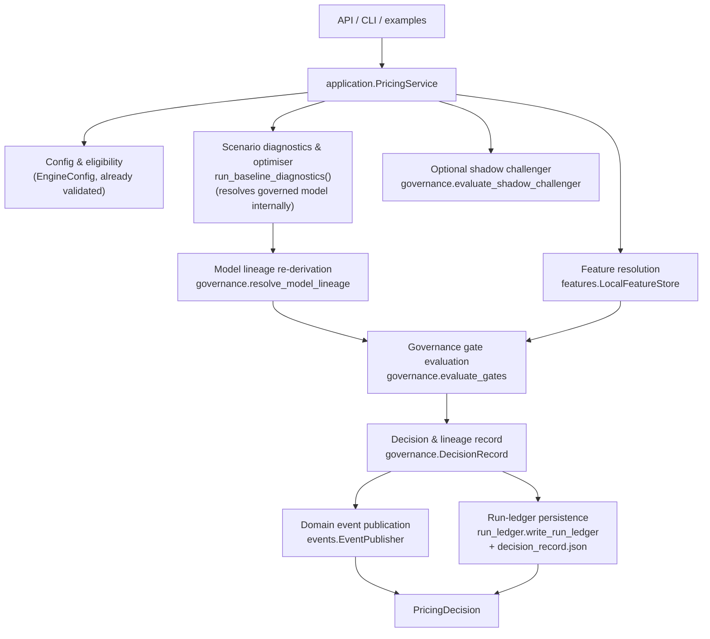

# Architecture Overview

The engine is organized as a small pipeline from assumptions to recommendations and diagnostics.

```text
configs/base.yaml
        |
        v
EngineConfig validation
        |
        v
synthetic customer generation
        |
        v
configured rate grids
  - market-relative spread grids
  - absolute fallback grids
        |
        v
response functions
  - home loan acceptance probability
  - term deposit uptake probability
  - optional approved-champion ML response adapter with synthetic fallback
        |
        v
economic objective
  + loan interest income
  - expected credit loss
  - capital charge
  - deposit interest cost
  - wholesale funding cost
  - funding shortfall penalty
  + excess deposit income
        |
        v
joint grid search
        |
        v
adaptive boundary follow-up
        |
        v
scenario diagnostics and sensitivity analysis
```

## Target Application Architecture (Modular Monolith)

The diagram above is the domain math pipeline. Around it, callers (the API, CLI, and
example scripts) go through a narrow application service instead of calling
`run_baseline_diagnostics()` directly:



This is a **modular monolith** (see `docs/adr/0001-modular-monolith-before-microservices.md`):
one deployable package with service-shaped internal boundaries, not a distributed system.
Note one sequencing nuance versus the idealised flow: `run_baseline_diagnostics(registry=...)`
already resolves the governed response function internally (existing behaviour, unchanged);
`PricingService` re-derives the same registry decision read-only afterwards
(`governance.lineage.resolve_model_lineage`) purely to attach lineage metadata, rather than
refactoring `scenarios/runner.py` to split "resolve" from "optimise" — see
`scenarios/runner.py`'s hotspot note below for why that refactor was deliberately not done.

New packages supporting this flow:

- `src/balance_pricing_engine/application/`: `PricingService.run_scenario()` — the single
  orchestration entry point. Accepts a `PricingScenarioRequest`, returns a `PricingDecision`.
  Imports no delivery-layer dependency (no FastAPI). `GovernanceError` from a broken approved
  champion propagates out unchanged — never downgraded to a soft decision.
- `src/balance_pricing_engine/features/`: `FeatureProvider` protocol, versioned/fingerprinted
  `FeatureSchema` definitions centralizing `modelling/datasets.py`'s column lists, and
  `LocalFeatureStore` (the only implementation today). See
  `docs/adr/0002-local-feature-store-interface.md`.
- `src/balance_pricing_engine/governance/`: `evaluate_gates()` (typed `GateResult`s →
  `DecisionStatus`), `resolve_model_lineage()`, `DecisionRecord` (+ additive
  `decision_record.json`), and a narrow champion/challenger `evaluate_shadow_challenger()`
  seam. See `docs/adr/0003-governance-centred-decision-record.md`.
- `src/balance_pricing_engine/events/`: immutable `DomainEvent`s and an `EventPublisher`
  protocol (`NoOpEventPublisher` / `InMemoryEventPublisher` / `JSONLEventPublisher` /
  `KafkaEventPublisher`, the last requiring the `[kafka]` extra and a real broker). See
  `docs/adr/0004-in-process-events-before-streaming-platform.md`.
- `src/balance_pricing_engine/observability/`: structured JSON logging, correlation-ID
  propagation, and `ExecutionMetrics` stage timing — standard library only.

## Main Modules

- `src/balance_pricing_engine/config.py`: loads and validates YAML configuration.
- `src/balance_pricing_engine/rate_grids.py`: builds configured pricing grids from either
  market-relative spreads or absolute product grids.
- `src/balance_pricing_engine/synthetic/`: generates synthetic customers, market state, and response
  probabilities.
- `src/balance_pricing_engine/pricing/`: calculates objective components such as loan income,
  credit loss, maturity-adjusted RWA capital charge, deposit cost, wholesale funding cost, and
  funding shortfall penalty.
- `src/balance_pricing_engine/optimization/grid_search.py`: evaluates rate pairs and selects the
  highest-objective result, optionally applying a portfolio ROE floor before winner selection.
- `src/balance_pricing_engine/diagnostics.py`: explains objective components, detects boundary
  issues, expands grids when needed, and runs sensitivity cases.
- `src/balance_pricing_engine/scenarios/runner.py`: orchestrates baseline scenario diagnostics and
  artifact persistence.
- `src/balance_pricing_engine/scenarios/multiperiod.py`: rolls baseline diagnostics across multiple
  future periods and discounts the resulting objective contributions.
- `src/balance_pricing_engine/run_ledger/`: creates governed pricing-run ledgers by wrapping
  diagnostics artifacts with metadata, configuration snapshots, pricing memos, and governance
  checklists.
- `src/balance_pricing_engine/modelling/`: builds synthetic observed datasets and trains
  response models, including optional LightGBM, XGBoost, and survival/hazard adapters. These models
  can influence optimization only when `run_baseline_diagnostics(registry=...)` resolves an
  approved compatible champion through `ModelScoringAgent`; otherwise the deterministic synthetic
  response functions remain in use.

## Extension Boundaries

`EngineConfig` is the validated input contract for scenario intent. It should remain a boundary for
assumptions such as market state, pricing mode, balance-sheet settings, response settings, and
multi-period controls. Avoid storing operational state, run outputs, or audit artifacts on
`EngineConfig`; those belong in diagnostics, ledgers, or generated artifacts.

`ScenarioDiagnostics` is the output contract for a completed scenario. It packages the winning
`OptimizationResult`, the evaluated grid surface, boundary metadata, optional cohort context, and
artifact writing. API, dashboard, reporting, LLM narration, run ledger, and multi-period flows should
consume this contract rather than reaching into optimizer internals.

The approved-champion ML path is an optional extension seam. The baseline runner may ask
`ModelScoringAgent` to resolve response functions from a registry, but only an approved compatible
champion with a loadable artifact is adapted into the optimizer. When no approved compatible
champion exists, the runner falls back to the deterministic synthetic response functions. An
approved champion whose artifact is missing or unloadable instead raises `GovernanceError` — that
inconsistent governed state must fail loud rather than silently reprice on synthetic.

`PricingDecision` is the application-level output contract for a *decision*, layered on top
of `ScenarioDiagnostics` rather than replacing it. It should remain the entry point for new
delivery surfaces (new API endpoints, CLI commands); it wraps `ScenarioDiagnostics` in
governance evaluation, lineage, and event publication without changing what
`ScenarioDiagnostics`/`OptimizationResult` mean or contain.

## Architecture Hotspots

`src/balance_pricing_engine/scenarios/runner.py` is the main orchestration hotspot. It currently
coordinates baseline execution, segmented pricing routing, diagnostics wrapping, artifact
persistence, cohort attribution, and segmented-to-standard result conversion. Keep future changes
small here; if responsibilities grow, prefer moving artifact writing or segmented conversion into
dedicated modules while preserving `ScenarioDiagnostics` as the public output contract.
`application.PricingService` orchestrates *around* this module (governance, lineage, events,
decision records) rather than inside it — that orchestration growth was deliberately kept out of
`runner.py` to avoid making this hotspot larger.

`src/balance_pricing_engine/modelling/agentic.py` is the governed modelling hotspot. It contains
model abstractions, registry governance, training, scoring, champion promotion, response adapters,
and fallback behavior. The current public surface is covered by tests, but future expansion should
prefer narrower modules such as registry, training, scoring, and response-model adapters while
keeping existing imports stable.

## Adaptive Boundary Flow

The baseline and sensitivity runners start with the configured grid. If the accepted result is at a
minimum or maximum boundary, the hit side of the grid is expanded by the current grid span and the
search is rerun. Expansion stops when the accepted result is no longer at a boundary or when the
maximum expansion count is reached.

The final `boundary_warning_flag` reports the accepted result after expansion. The
`initial_boundary_warning_flag` and `expansion_rounds` fields show whether remediation was needed.
If the final flag remains true, the optimum may still sit outside the searched domain and the
boundary issue should remain open for review.

## Multi-Period Scenario Roll

`MultiPeriodConfig` enables a portfolio-level scenario roll through
`run_multiperiod_diagnostics()`. Each period runs the standard baseline diagnostics with the period's
market assumptions, carries prior-period loan income and deposit cost as back-book economics, applies
`loan_runoff_rate` and `deposit_runoff_rate` to that back book each period, and reports a discounted
NPV using `discount_rate`.

The key configuration fields are `n_periods`, `loan_runoff_rate`, `deposit_runoff_rate`,
`discount_rate`, `reinvestment_spread_bps`, and `market_cash_rate_drift_bps`. Surviving back-book
loan balances earn a reinvestment rate of cash rate plus `reinvestment_spread_bps`. The cash-rate
drift shifts the cash rate used in later periods; competitor loan and deposit rates remain fixed, so
a warning is emitted when cash-rate drift is configured because competitor gaps will move
mechanically.

## Artifact Flow

`ScenarioDiagnostics.write_artifacts()` writes baseline regression outputs:

- `grid_results.csv`: every final evaluated rate pair
- `top_results.csv`: highest objective candidates
- `counterfactuals.csv`: one-axis objective decompositions for top candidates
- `cohort_attribution.csv`: expected winning volumes by coarse synthetic customer segment, when
  cohort context is available
- `sensitivity.csv`: sensitivity output, when provided
- `summary.json`: accepted recommendation and boundary metadata

The run ledger layer is the preferred output orchestration path for reproducible records.
`write_run_ledger()` creates a collision-safe directory under `data/outputs/runs/` using a single
UTC timestamp for both the directory name and `metadata.json`, then writes:

- `metadata.json`: run ID, timestamp, config hash, git/package details, and governance flags
- `config_snapshot.yaml`: exact YAML configuration used for the run
- the diagnostics artifacts listed above
- `pricing_memo.md`: business-facing recommendation, decomposition, sensitivity, and risk notes
- `governance_checklist.md`: manual review checklist for accepting the recommendation

Artifact filenames inside a ledger directory remain fixed. Reusing an output directory can overwrite
prior files, so run ledger directory creation is atomic and appends a numeric suffix if a same-timestamp
directory already exists.

## NZ pricing intelligence

Public NZ bank pricing enters the engine through a separate intelligence layer
that answers "what is the market doing?" and hands the optimiser a competitor
assumption. It never prices anything itself.

```text
Official NZ bank websites
   -> competitor_rates/collectors/{anz,asb,bnz,westpac,kiwibank}.py
   -> CompetitorRateRecord (canonical model + provenance)
   -> pricing_intelligence/validation.py
   -> pricing_intelligence/store.py            (SQLite historical observations)
   -> pricing_intelligence/changes.py          (RateChange events)
   -> pricing_intelligence/snapshot.py         (per-term ranking + dispersion)
   -> pricing_intelligence/strategy.py         <-- the only seam into pricing
   -> EngineConfig.market.competitor_loan_rate
   -> scenarios/runner.py -> optimization/grid_search.py
```

`strategy.apply_market_strategy_to_config()` supports `MANUAL` (default,
config returned unchanged), `MARKET_MEDIAN`, `MARKET_LEADER`,
`MARKET_SECOND_LOWEST`, and `MARKET_MEAN`, with an `offset_bps` shift.

Full detail: [pricing_intelligence.md](pricing_intelligence.md).
